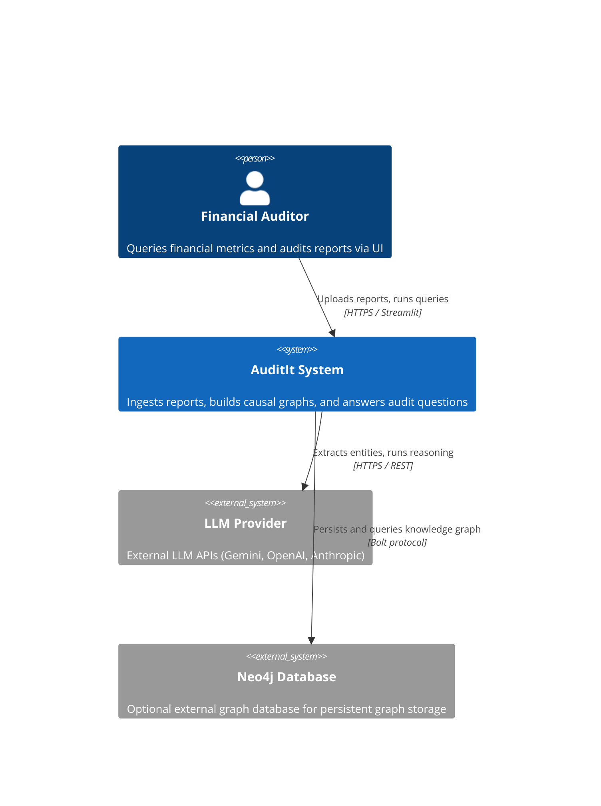
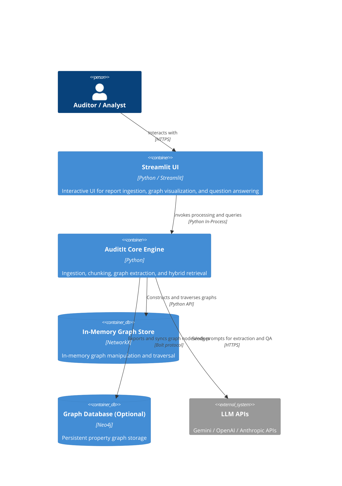
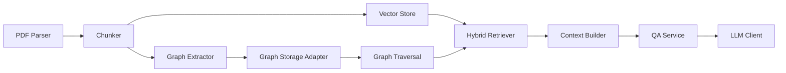

# Architecture - AuditIt

> **Last updated:** 2026-10-19
> **Status:** Draft

## Overview

AuditIt is a financial audit and analysis system that models causal relationships among metrics, financial ratios, and report disclosures using knowledge graphs. It ingests financial documents such as 10-K and annual reports, constructs queryable graphs with NetworkX and Neo4j adapters, and combines graph traversal with LLM reasoning to answer audit and financial inquiries with source citations.

---

## Level 1 - System Context

The system ingests financial reports from analysts and auditors, constructs an internal graph representation, and interfaces with external LLM providers and optional graph databases.

**External dependencies:**

| System | Purpose | Owner | SLA |
| --- | --- | --- | --- |
| LLM Provider (Gemini / OpenAI / Anthropic) | Entity extraction, graph relationship extraction, and response generation | External API provider | <!-- TODO: fill in --> |
| Neo4j (Optional) | Persistent graph storage and Cypher query execution | Neo4j / Self-hosted | <!-- TODO: fill in --> |

---

## Level 2 - Containers

AuditIt runs as a local or containerized application with a Streamlit interface and core processing engine.

**Container inventory:**

| Container | Technology | Responsibility | Scales |
| --- | --- | --- | --- |
| Streamlit UI | Python, Streamlit | Document upload, graph visualization, chat and citations interface | Vertically |
| Core Engine | Python 3.13+ | PDF parsing, chunking, graph extraction, hybrid retrieval, QA service | Horizontally / Worker processes |
| In-Memory Store | NetworkX | Local graph operations and fast traversal | In-process memory |
| Neo4j Adapter (Optional) | Neo4j | Long-term graph persistence and cross-document graph queries | Vertically + clustering |

---

## Level 3 - Components

### Core Engine Components

Component responsibilities:
- **PDF Parser**: Extracts raw text, metadata, and structural layout from financial PDFs.
- **Chunker**: Splits document text into manageable segments preserving context.
- **Graph Extractor**: Identifies financial metrics and causal links via rules and LLM calls.
- **Graph Storage Adapter**: Abstracts graph persistence across NetworkX and Neo4j.
- **Hybrid Retriever**: Combines semantic text retrieval with graph-based neighbor expansion.
- **Context Builder**: Formats retrieved nodes, edges, and chunks into LLM prompt contexts.
- **QA Service**: Manages question answering workflows and citation validation.
- **LLM Client**: Handles provider-specific API calls (Gemini, OpenAI, Anthropic).

---

## Key Architectural Decisions

- **Graph-based financial modeling**: Captures causal relationships between metrics and ratios rather than relying only on flat text retrieval.
- **Dual graph backend (NetworkX + Neo4j)**: NetworkX provides fast local execution and algorithm support; Neo4j adapter provides persistence and Cypher querying. See [ADR-001](docs/adr/001-dual-graph-backend-networkx-and-neo4j.md).
- **Hybrid retrieval pipeline**: Merges vector similarity search with structured graph traversal to build grounded context for LLM generation. See [ADR-002](docs/adr/002-hybrid-retrieval-graph-traversal-and-vector-search.md).
- **Bring Your Own Key (BYOK) model integration**: Direct integration with Gemini, OpenAI, and Anthropic APIs configured through environment variables.

---

## Data Flow - Key Scenarios

### Document Ingestion and Graph Construction Flow

`PDF Upload -> Document Loader -> PDF Parser (pypdf / LlamaParse) -> Chunker -> Graph Extractor (LLM + Financial Rules) -> Graph Store (NetworkX / Neo4j)`

### Audit Question Answering Flow

`User Query -> Hybrid Retriever (Vector Search + Graph Traversal) -> Context Builder -> QA Service -> LLM Client -> Response with Citations & Graph View`

---

## Infrastructure

| Environment | Platform | Region | Notes |
| --- | --- | --- | --- |
| Production | Docker / Cloud Container <!-- TODO: fill in --> | <!-- TODO: fill in --> | Planned container deployment |
| Local dev | Local Python 3.13+ (managed via uv) / Docker Compose | Local | In-memory NetworkX with optional local Neo4j container |

---

## Non-Functional Characteristics

| Property | Target | Current |
| --- | --- | --- |
| Availability | <!-- TODO: fill in --> | Pre-release |
| Query Latency | <!-- TODO: fill in --> | Pre-release |
| Document Ingestion Throughput | <!-- TODO: fill in --> | Pre-release |

---

## Related Documents

- [ADR Index](docs/adr/)
- [Concepts](docs/concepts/)
- [Runbooks](docs/runbooks/)
- [AI Context Guide](CONTEXT.md)
