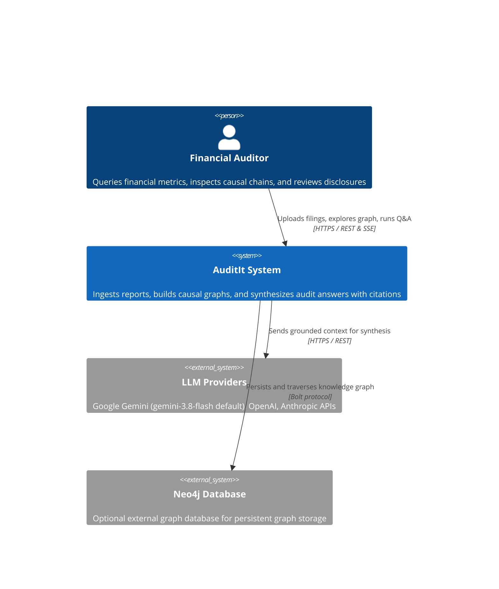
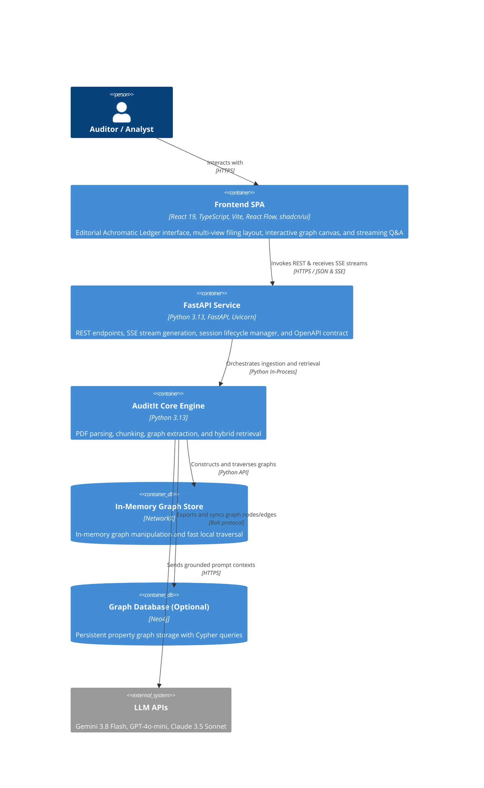
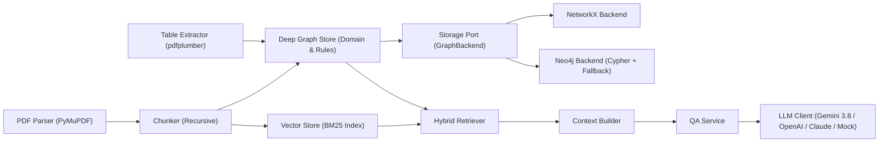

# Architecture - AuditIt System

> **Last updated:** 2026-10-21  
> **Status:** Accepted

## Overview

AuditIt is a full-stack financial report analysis system that converts corporate filings (such as 10-K and annual reports) into queryable causal knowledge graphs. It extracts financial metrics, accounting disclosures, and tabular statements, connects them by cause-to-effect relationships, and provides grounded question answering with page-level citations.

The system runs as a decoupled monorepo with an interactive React single-page application frontend and an asynchronous FastAPI backend service.

---

## Level 1 - System Context

The system interfaces with financial analysts and auditors, external LLM reasoning providers, and optional persistent graph databases.

**External dependencies:**

| System | Purpose | Owner | SLA |
| --- | --- | --- | --- |
| LLM Providers (Gemini / OpenAI / Anthropic) | Cloud reasoning and response synthesis | External API provider | External provider SLA |
| Neo4j (Optional) | Long-term property graph persistence and Cypher execution | Neo4j / Self-hosted | Local / Team managed |

---

## Level 2 - Containers

AuditIt separates presentation from domain logic, operating with an interactive client, a stateless API gateway, and core extraction engines.

**Container inventory:**

| Container | Technology | Responsibility | Scaling Model |
| --- | --- | --- | --- |
| Frontend SPA | React 19, TypeScript, Vite, Tailwind v4, React Flow | Document upload, causal graph visualization, table viewer, streaming Q&A | Static CDN / Vercel / Nginx |
| FastAPI Backend | Python 3.13, FastAPI, Uvicorn | Session manager, background ingestion jobs, REST routes, SSE streaming | Cloud container / Render / Railway |
| Core Engine | Python 3.13 | PDF parsing, chunking, table extraction, hybrid retrieval, QA service | In-process worker |
| In-Memory Store | NetworkX | Local graph operations, zero-dependency CI testing, fast traversal | Process memory |
| Neo4j Adapter (Optional) | Neo4j 5.x | Long-term graph persistence across service restarts | Dedicated database container |

---

## Level 3 - Components

### Core Engine Components

### Component responsibilities:
- **PDF Parser**: Extracts raw text, structural layout, and page geometry from financial PDFs.
- **Table Extractor**: Identifies tabular disclosures and extracts structured balance sheets and statements.
- **Chunker**: Splits document text into manageable segments while preserving exact page boundaries.
- **Deep Graph Store (`GraphStore`)**: Encapsulates entity matching, canonical metric aliases, accounting causal rules, and neighborhood path extraction.
- **Storage Port (`GraphBackend`)**: Clean abstract contract decoupling domain logic from graph persistence engines.
- **NetworkX Backend**: In-memory, zero-dependency graph implementation for local execution and automated testing.
- **Neo4j Backend**: Persistent property graph engine executing Cypher statements with automatic fallback.
- **Vector Store**: In-memory BM25 retrieval index for text chunks.
- **Hybrid Retriever**: Coordinates text similarity search with graph traversal into a unified retrieval result.
- **Context Builder**: Formats retrieved nodes, edges, and chunks into LLM prompt contexts with citations.
- **QA Service**: Manages question answering workflows, fallback handling, and citation validation.
- **LLM Client**: Multi-provider client adapter supporting Gemini (default: `gemini-3.8-flash`), OpenAI, Anthropic, and offline execution.

---

## Key Architectural Decisions

- **Decoupled Monorepo Architecture**: Keeps frontend and backend co-located with dedicated build toolchains (`npm` + Vite for frontend, `uv` for backend) and unified development via root npm scripts.
- **Multi-View Filing Hub**: Organizes analysis into focused sub-views accessible via top navigation tabs and direct links:
  - **Overview**: Executive dashboard with feature cards, quick inquiry bar, and extracted tables preview.
  - **Causal Graph**: React Flow canvas with Dagre directed layout, hop depth controls, and node inspection.
  - **Q&A Console**: Real-time streaming response console with full Markdown rendering, citation snippets, and engine provenance badge.
  - **Financial Tables**: Searchable statement viewer with figure alignment and column detection.
- **Dual Graph Backend (NetworkX + Neo4j)**: Uses a Ports and Adapters architecture. The deep `GraphStore` module encapsulates entity normalization, canonical aliases, accounting causal rules, and neighborhood traversal. Storage engines implement `GraphBackend` via `NetworkXBackend` (in-memory) and `Neo4jBackend` (native Cypher with automatic in-memory fallback).
- **Hybrid Retrieval Pipeline**: Combines BM25 text keyword matching with directed graph traversal to supply grounded context and verified causal paths for response synthesis.
- **Bring Your Own Key (BYOK) Security**: User API keys are stored in browser `localStorage` and passed per request via the `X-LLM-Key` header. Keys are never written to disk by the backend.
- **Reverse Proxy Routing**: Development uses Vite's proxy (`/api` -> `http://localhost:8000`). Production uses Nginx in Docker or direct cross-origin calls configured via `VITE_API_BASE_URL` and `CORS_ORIGINS`.

---

## Data Flow - Key Scenarios

### 1. Document Ingestion and Graph Construction

`PDF Upload -> FastAPI Router -> SessionManager -> Ingestion Pipeline -> GraphStore (Rules & Normalization) -> VectorStore`

1. PDF is uploaded or selected from sample filings.
2. Ingestion pipeline extracts text, page numbers, financial tables, and metric mentions.
3. Accounting domain rules infer directed causal edges between financial metrics and footnotes.
4. Chunks are indexed in the in-memory BM25 vector store.
5. Ingestion job signals completion and filing enters `Ready` status.

### 2. Audit Question Answering Flow

`User Query -> FastAPI SSE Endpoint -> Hybrid Retriever -> Context Builder -> QAService -> SSE Token Streaming -> React UI`

1. User submits a question via the Q&A console or filing overview quick-ask bar.
2. Hybrid retriever queries BM25 text index and traverses knowledge graph for relevant metric paths.
3. Context builder constructs an audit prompt with exact page citations and causal chains.
4. QA service calls the selected engine (`gemini-3.8-flash` or offline engine).
5. Tokens stream to the UI in real time along with citation metadata, causal paths, and execution latency.

---

## Infrastructure and Deployment

| Environment | Frontend Platform | Backend Platform | Notes |
| --- | --- | --- | --- |
| Local Development | Vite (`localhost:5173`) | FastAPI (`localhost:8000`) | Unified start via `npm run dev` |
| Split Cloud (Recommended) | Vercel | Render / Railway / Cloud Run | Configured via `VITE_API_BASE_URL` and `CORS_ORIGINS` |
| Standalone Docker | Nginx container (:80) | Python container (:8000) | Multi-stage Dockerfiles with reverse proxy |

---

## Related Documents

- [Developer Context Primer](CONTEXT.md)
- [Project Readme](README.md)
- [Domain Glossary](backend/GLOSSARY.md)
- [Architecture Decision Records](backend/docs/adr/)
- [Concepts](backend/docs/concepts/)
