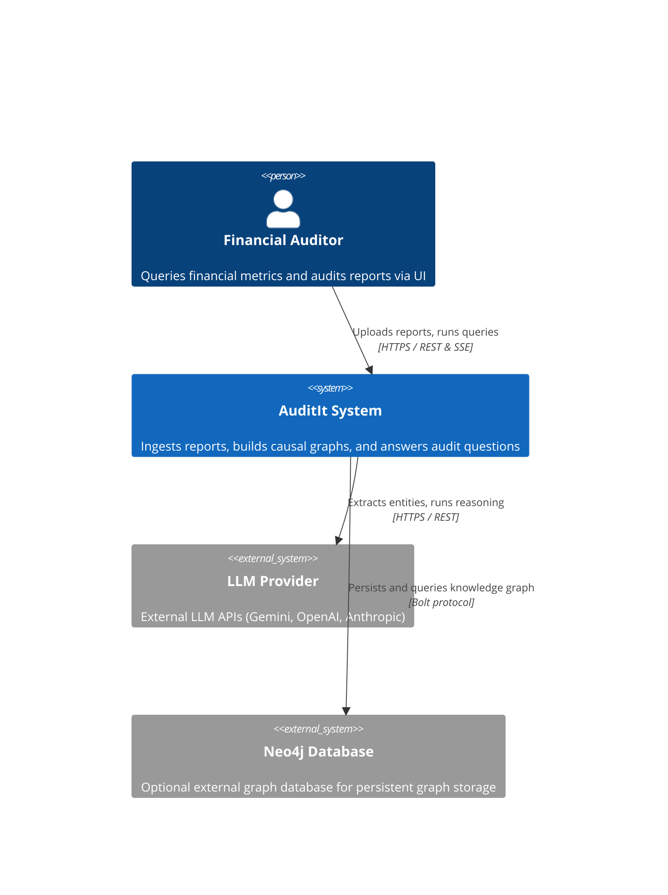
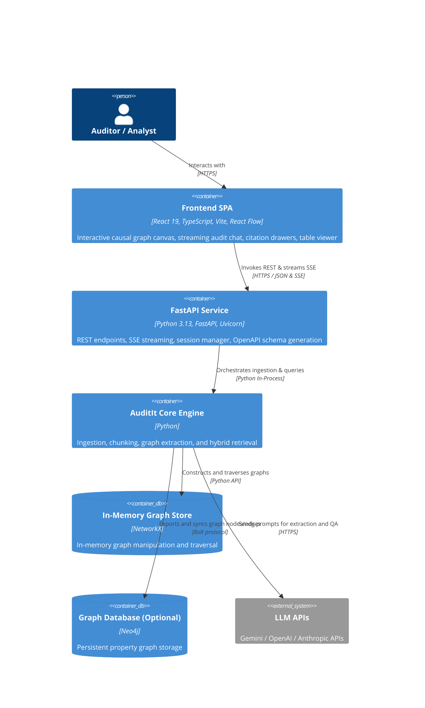
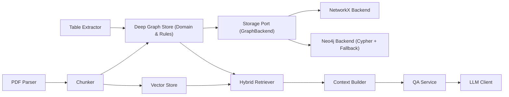

# Architecture - AuditIt

> **Last updated:** 2026-10-21
> **Status:** Accepted

## Overview

AuditIt is a financial audit and analysis system that models causal relationships among metrics, financial ratios, and report disclosures using knowledge graphs. It ingests financial documents such as 10-K and annual reports, constructs queryable graphs with NetworkX and Neo4j adapters, and combines graph traversal with LLM reasoning to answer audit and financial inquiries with source citations.

---

## Level 1 - System Context

The system ingests financial reports from analysts and auditors, constructs an internal graph representation, and interfaces with external LLM providers and optional graph databases.

**External dependencies:**

| System | Purpose | Owner | SLA |
| --- | --- | --- | --- |
| LLM Provider (Gemini / OpenAI / Anthropic) | Response generation and optional cloud reasoning | External API provider | External provider SLA |
| Neo4j (Optional) | Persistent property graph storage and Cypher query execution | Neo4j / Self-hosted | Local / Team managed |

---

## Level 2 - Containers

AuditIt runs as a decoupled monorepo with an interactive React SPA frontend, an asynchronous FastAPI backend service, and core processing engines.

**Container inventory:**

| Container | Technology | Responsibility | Scales |
| --- | --- | --- | --- |
| Frontend SPA | React 19, TypeScript, Vite, React Flow, Tailwind | Document upload, Dagre causal graph exploration, citation drawer, SSE chat | Horizontally (Static CDN / SPA) |
| FastAPI Backend | Python 3.13, FastAPI, Uvicorn | Session manager, OpenAPI contract, background ingestion jobs, SSE streaming | Horizontally |
| Core Engine | Python 3.13+ | PDF parsing, chunking, graph extraction, hybrid retrieval, QA service | Horizontally / Worker processes |
| In-Memory Store | NetworkX | Local graph operations, zero-dependency CI testing, fast traversal | In-process memory |
| Neo4j Adapter (Optional) | Neo4j | Long-term graph persistence and cross-document graph queries | Vertically + clustering |

---

## Level 3 - Components

### Core Engine Components

Component responsibilities:
- **PDF Parser**: Extracts raw text, metadata, and structural layout from financial PDFs.
- **Table Extractor**: Identifies tabular financial disclosures and extracts structured metrics.
- **Chunker**: Splits document text into manageable segments preserving exact page numbers.
- **Deep Graph Store (`GraphStore`)**: Encapsulates entity matching, canonical metric aliases, accounting causal rules, and neighborhood path extraction.
- **Storage Port (`GraphBackend`)**: Clean contract decoupling domain logic from graph persistence engines.
- **NetworkX Backend**: In-memory, zero-dependency graph implementation for local execution and automated testing.
- **Neo4j Backend**: Persistent property graph engine executing Cypher statements with automatic fallback.
- **Vector Store**: In-memory BM25 retrieval index for text chunks.
- **Hybrid Retriever**: Coordinates text similarity search with graph traversal into a unified retrieval result.
- **Context Builder**: Formats retrieved nodes, edges, and chunks into LLM prompt contexts with citations.
- **QA Service**: Manages question answering workflows and citation validation.
- **LLM Client**: Handles provider-specific API calls (Gemini, OpenAI, Anthropic) and offline execution.

---

## Key Architectural Decisions

- **Decoupled Client-Server Monorepo**: Decouples presentation from domain logic with a modern React SPA and FastAPI service in a unified repository (`auditit/backend` and `auditit/frontend`).
- **Interactive Causal Graph Exploration**: Upgraded from static Mermaid diagrams to an interactive node-and-edge canvas (React Flow + `@dagrejs/dagre`) supporting click-to-inspect causal path tracing.
- **Dual graph backend (NetworkX + Neo4j)**: Implemented via a Ports and Adapters architecture. The deep `GraphStore` module encapsulates entity normalization, canonical aliases, accounting causal rules, and neighborhood traversal. Storage engines implement the `GraphBackend` port via `NetworkXBackend` (in-memory) and `Neo4jBackend` (native Cypher with automatic in-memory fallback). See [ADR-001](docs/adr/001-dual-graph-backend-networkx-and-neo4j.md).
- **Hybrid retrieval pipeline**: Merges vector similarity search with structured graph traversal to build grounded context for LLM generation. See [ADR-002](docs/adr/002-hybrid-retrieval-graph-traversal-and-vector-search.md).
- **Bring Your Own Key (BYOK) model integration**: Direct integration with Gemini, OpenAI, and Anthropic APIs configured through environment variables or UI session state.

---

## Data Flow - Key Scenarios

### Document Ingestion and Graph Construction Flow

`PDF Upload -> FastAPI Router -> SessionManager -> Ingestion Pipeline -> GraphStore (Rules & Normalization) -> VectorStore`

### Audit Question Answering Flow

`User Query -> FastAPI SSE Endpoint -> Hybrid Retriever -> Context Builder -> QAService -> SSE Token Streaming -> React UI`

---

## Infrastructure

| Environment | Platform | Region | Notes |
| --- | --- | --- | --- |
| Production | Docker / Cloud Container | Local / Cloud | Planned container deployment |
| Local dev | FastAPI (port 8000) + Vite (port 5173) | Local | Unified run via `npm run dev` |

---

## Non-Functional Characteristics

| Property | Target | Current |
| --- | --- | --- |
| Availability | 99.9% (production) | Local / Development |
| Query Latency | < 3s (hybrid retrieval + offline response) | Under 1.5s local execution |
| Document Ingestion | Complete parse in < 5s for 20-page 10-K | Verified under 2s on sample reports |

---

## Related Documents

- [Domain Glossary](GLOSSARY.md)
- [ADR Index](docs/adr/)
- [Concepts](docs/concepts/)
- [Runbooks](docs/runbooks/)
- [AI Context Guide](CONTEXT.md)
