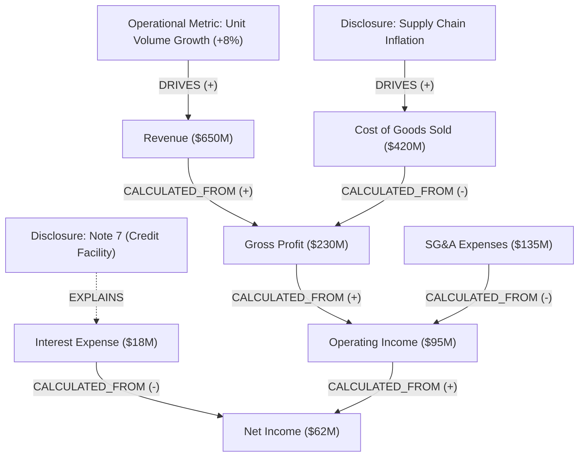

# 001: Modeling Financial Statements as Directed Causal Graphs

> **Relates to:** Financial data modeling, knowledge graph construction, graph traversal  
> **Prerequisites:** Basic knowledge of directed graphs and financial statement structures  
> **Canonical reference:** Pearl, J. (2009). *Causality: Models, Reasoning, and Inference*. Cambridge University Press.

---

## What this is

A causal financial graph is a directed attributed property graph that represents financial line items, operating metrics, and qualitative disclosures as nodes, and their mathematical or explanatory dependencies as directed edges. 

Standard financial statements provide isolated numerical tables (balance sheets, income statements, cash flow statements) alongside unstructured commentary (Management Discussion and Analysis, accounting footnotes). A causal graph models how changes in fundamental operating drivers propagate through accounting identities to affect higher-level financial metrics and performance ratios.

---

## How it works

Financial statement analysis relies on two distinct classes of dependencies:

1. **Deterministic accounting identities:** Exact mathematical formulas defined by standard accounting standards (for example, Gross Profit = Revenue - Cost of Goods Sold).
2. **Empirical or narrative causal drivers:** Qualitative relationships described in report disclosures where external conditions or operational factors influence a financial metric (for example, supply chain bottlenecks increasing raw material freight costs).

A causal financial graph captures both classes within a unified graph schema $G = (V, E)$.

### 1. Graph Formulation

The graph $G$ consists of two node sets and four primary edge types:

$$V = V_M \cup V_D$$

- **Metric Nodes ($V_M$):** Quantitative entities representing reported financial line items, intermediate totals, or calculated ratios. Attributes include:
  - `name`: Standardized metric identifier (e.g., `gross_profit`, `operating_cash_flow`).
  - `value`: Numerical scalar.
  - `unit`: Currency, ratio, percentage, or basis points.
  - `period`: Reporting window (e.g., `FY2025`, `Q3_2025`).
  - `statement_type`: Originating statement (`INCOME_STATEMENT`, `BALANCE_SHEET`, `CASH_FLOW`, etc.).
  - `source_page`: Document page index where the metric appears.

- **Disclosure Nodes ($V_D$):** Qualitative entities representing narrative footnotes, accounting policy explanations, or risk disclosures that ground observed metric movements. Attributes include:
  - `topic`: Categorical subject (e.g., `debt_covenants`, `foreign_exchange_exposure`).
  - `snippet`: Extracted textual evidence.
  - `source_page`: Document page index containing the disclosure.

### 2. Edge Semantics and Directionality

Edges $E \subseteq V \times V$ are directed from driver (cause) to target (effect). Every edge carries a relationship type, a directionality sign, and confidence weight:

- **`CALCULATED_FROM` (Deterministic):** Represents strict accounting arithmetic.
  - Example: `Revenue -> Gross Profit` (+), `COGS -> Gross Profit` (-).
  - Direction: Direct positive or direct inverse.

- **`DRIVES` (Operational / Causal):** Represents direct causal contribution documented in financial narrative.
  - Example: `Store Count -> Revenue` (Direct).
  - Example: `Raw Material Price Inflation -> Cost of Goods Sold` (Direct).

- **`OFFSETS` (Counteracting Impact):** Represents mitigating factors that diminish an adverse change.
  - Example: `Price Increases -> Unit Volume Decline` (Offsets margin deterioration).

- **`EXPLAINS` (Grounding Link):** Connects a qualitative `DisclosureNode` to a `MetricNode` or operational driver.
  - Example: `Footnote 8 (Debt Covenants) -> Total Debt`.

### 3. Structural Visual Representation

The following diagram illustrates how deterministic accounting identities interface with qualitative footnote disclosures:

### 4. Traversal and Impact Propagation

Causal graphs allow deterministic upstream and downstream queries:

- **Upstream Root-Cause Analysis (Predecessor Traversal):**
  Given a target metric $m \in V_M$ experiencing an unexpected variance (for example, Gross Margin contraction of 180 basis points), traverse incoming edges to find root causes:

  $$\text{Drivers}(m) = \{ u \in V \mid \exists \text{ path } u \to \dots \to m \}$$

  This separates the mechanical accounting drivers (COGS growth exceeded Revenue growth) from the operational explanations (supplier price hikes cited on Page 42).

- **Downstream Sensitivity Traversal (Successor Traversal):**
  Given a shock to an operational driver $s \in V$ (for example, an increase in benchmark interest rates), traverse outgoing edges to project all impacted metrics:

  $$\text{Impacts}(s) = \{ v \in V \mid \exists \text{ path } s \to \dots \to v \}$$

---

## Trade-offs

### Advantages

- **Traceable Attribution:** Replaces ungrounded text summaries with explicit path-based provenance. Every link points to an exact calculation or cited disclosure snippet.
- **Deduplication Across Filings:** Mapping report text to canonical node keys allows comparing identical metrics across quarters even when tabular formatting changes.
- **Hybrid Retrieval Foundation:** Enables graph neighbor expansion to retrieve multi-hop context that semantic vector search alone often misses.

### Limitations and Failure Modes

- **Extraction Sensitivity:** Missing a single intermediate node (such as Operating Expenses) breaks the causal chain between Gross Profit and Net Income.
- **Cycle Handling:** While individual period accounting statements form Directed Acyclic Graphs (DAGs), multi-period models or macroeconomic feedback loops (e.g., Debt -> Interest Expense -> Cash Flow -> Borrowing Need) introduce cycles. Traversal algorithms must enforce maximum hop limits or cycle detection.
- **Narrative Ambiguity:** Companies frequently disclose multiple concurrent drivers without quantifying their individual contributions (e.g., "Margins decreased due to freight inflation, partially offset by favorable pricing"). In these cases, edges carry qualitative directionality rather than exact coefficients.

---

## Further reading

- Pearl, J. (2000). *Causality: Models, Reasoning, and Inference*. Cambridge University Press.
- Peters, J., Janzing, D., and Schölkopf, B. (2017). *Elements of Causal Inference: Foundations and Learning Algorithms*. MIT Press.
- Financial Accounting Standards Board (FASB). *Accounting Standards Codification (ASC)*. Deterministic accounting formulas and financial statement presentation rules.
