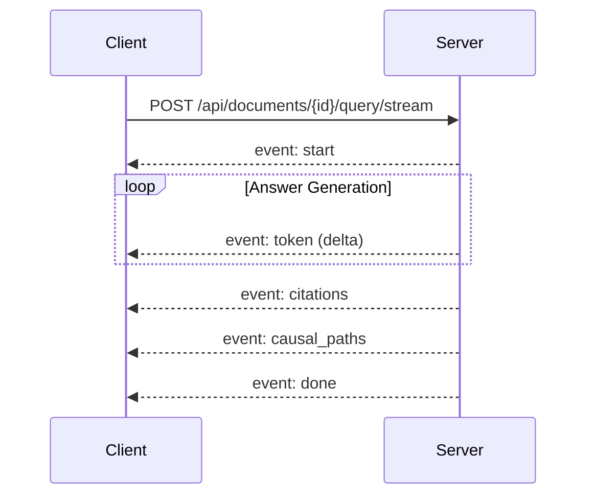

AuditIt streams question answering results progressively using standard Server-Sent Events (SSE). This architecture allows long synthesis operations to stream tokens to the UI while executing citation ranking and graph path extraction.

---

## Endpoint Details

- **Method**: `POST`
- **Path**: `/api/documents/{doc_id}/query/stream`
- **Request Headers**:
  - `Content-Type: application/json`
  - `X-Session-ID: <session_id>` (optional, defaults to `"default"`)
  - `X-LLM-Key: <api_key>` (optional, required if using BYOK cloud model)
- **Response Headers**:
  - `Content-Type: text/event-stream`
  - `Cache-Control: no-cache`
  - `Connection: keep-alive`
  - `X-Accel-Buffering: no`

---

## Event Lifecycle

The streaming endpoint sends events in a strict sequence:



---

## Event Payloads

### 1. `start`

Signifies that retrieval has completed and synthesis has commenced.

```
event: start
data: {"status": "reasoning", "provider": "Gemini"}
```

### 2. `token`

Delivers small readable chunks of synthesized text (typically 2 to 4 words).

```
event: token
data: {"delta": "Operating income declined "}
```

### 3. `citations`

Delivers the complete list of text chunks cited in the answer, complete with page numbers.

```
event: citations
data: [
  {
    "citation_id": "c_1",
    "source_doc_id": "doc_92a1",
    "source_filename": "northwind_fy24.pdf",
    "page_number": 42,
    "citation_type": "FOOTNOTE",
    "snippet": "Supply chain inflation drove freight expenses upward by 14%...",
    "relevance_score": 0.88
  }
]
```

### 4. `causal_paths`

Delivers verified relationship sequences traversed in the causal knowledge graph.

```
event: causal_paths
data: [
  {
    "path_id": "p_1",
    "source_node_name": "Supply Chain Inflation",
    "target_node_name": "Gross Profit",
    "node_sequence": ["Supply Chain Inflation", "Cost of Goods Sold", "Gross Profit"],
    "relationship_sequence": ["DRIVES (+)", "CALCULATED_FROM (-)"],
    "narrative_explanation": "Direct operational driver leading to gross profit contraction"
  }
]
```

### 5. `done`

Closes the stream with metadata including round-trip latency.

```
event: done
data: {"query_id": "q_88bf", "latency_ms": 612, "model_provider": "gemini"}
```

---

## TypeScript Client Example

The following snippet demonstrates how `frontend/src/api/client.ts` consumes the stream using standard `fetch` and `ReadableStreamDefaultReader`:

```typescript title="client-stream.ts"
const response = await fetch(`/api/documents/${docId}/query/stream`, {
  method: "POST",
  headers: {
    "Content-Type": "application/json",
    "X-Session-ID": sessionId,
    ...(apiKey ? { "X-LLM-Key": apiKey } : {}),
  },
  body: JSON.stringify({ query_text: question, model_provider: provider }),
});

const reader = response.body?.getReader();
const decoder = new TextDecoder();

let buffer = "";
while (reader) {
  const { value, done } = await reader.read();
  if (done) break;

  buffer += decoder.decode(value, { stream: true });
  const lines = buffer.split("\n\n");
  buffer = lines.pop() || "";

  for (const block of lines) {
    const [eventLine, dataLine] = block.split("\n");
    const eventType = eventLine.replace("event: ", "").trim();
    const payload = JSON.parse(dataLine.replace("data: ", "").trim());

    if (eventType === "token") onToken(payload.delta);
    if (eventType === "citations") onCitations(payload);
    if (eventType === "causal_paths") onPaths(payload);
    if (eventType === "done") onComplete(payload);
  }
}
```
