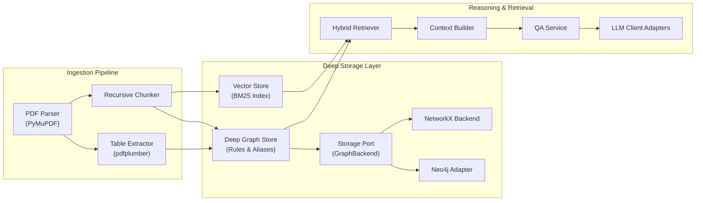

The Core Engine component architecture decouples document parsing from graph modeling, and separates graph storage mechanics from domain retrieval logic.

---

## Component Architecture

---

## Component Responsibilities

### Ingestion Components

- **PDF Parser (`src/ingestion/pdf_parser.py`)**: Uses PyMuPDF to extract raw text, typography, and page geometry from financial PDFs while maintaining exact bounding boxes.
- **Table Extractor (`src/ingestion/table_extractor.py`)**: Uses `pdfplumber` to isolate table structures, identify headers, and extract structured metrics into standardized balance sheets and income statements.
- **Recursive Chunker (`src/ingestion/chunker.py`)**: Splits document text recursively preserving paragraph integrity and document page metadata.

---

### Deep Graph Storage Components

<Callout type="info">
  Deep Module Pattern: Callers never touch internal NetworkX or Neo4j data structures directly. The `GraphStore` encapsulates entity normalization, canonical aliases, accounting causal rules, and neighborhood traversal queries behind clean domain methods.
</Callout>

- **Deep Graph Store (`src/db/graph/store.py`)**: Owns accounting domain rules, canonical entity alias mappings, and graph neighborhood traversal queries.
- **Storage Port (`src/db/graph/storage/base.py`)**: Abstract base contract defining node and edge insertion, neighborhood resolution, and path extraction methods.
- **NetworkX Backend (`src/db/graph/storage/networkx_store.py`)**: In-memory, zero-dependency graph implementation for local execution and automated testing.
- **Neo4j Backend (`src/db/graph/storage/neo4j_adapter.py`)**: Persistent property graph engine executing Cypher statements with automatic fallback.
- **Vector Store (`src/retrieval/vector_store.py`)**: In-memory BM25 lexical ranking index providing keyword search across document text chunks.

---

### Reasoning and Retrieval Components

- **Hybrid Retriever (`src/retrieval/hybrid_retriever.py`)**: Coordinates lexical search results with multi-hop graph paths into a unified ranked context.
- **Context Builder (`src/retrieval/context_builder.py`)**: Formats retrieved nodes, edges, and chunks into LLM prompt contexts with citations.
- **QA Service (`src/reasoning/qa_service.py`)**: Manages question answering workflows, fallback handling, and citation validation.
- **LLM Client (`src/reasoning/llm_client.py`)**: Multi-provider client adapter supporting Gemini (default: `gemini-3.8-flash`), OpenAI, Anthropic, and offline execution.
