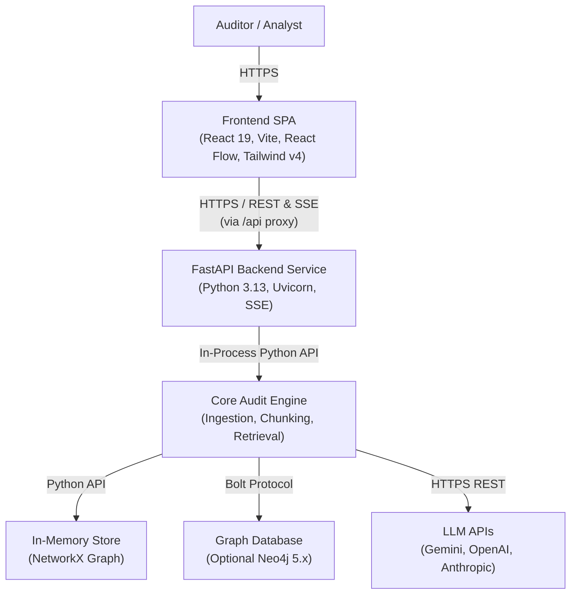

The Container tier shows the high-level executable processes that constitute the AuditIt system, their respective runtime environments, and communication boundaries.

---

## Container Diagram

---

## Container Inventory

| Container | Runtime / Tech Stack | Primary Responsibility | Scaling Strategy |
| :--- | :--- | :--- | :--- |
| **Frontend SPA** | React 19, TypeScript, Vite, Tailwind v4, React Flow, shadcn/ui | Editorial Achromatic Ledger UI, interactive causal graph canvas, statement viewer, and real-time SSE streaming Q&A. | Static CDN (Vercel, Cloudflare Pages, Nginx container) |
| **FastAPI Backend** | Python 3.13, FastAPI, Uvicorn, Pydantic | REST endpoints, Server-Sent Events generation, session lifecycle management, and OpenAPI contract. | Horizontally scalable container (Cloud Run, Render, Railway) |
| **Core Engine** | Python 3.13 | PDF layout extraction, recursive chunking, tabular statement parsing, accounting rule evaluation, and hybrid retrieval. | In-process asynchronous worker threads |
| **In-Memory Store** | NetworkX 3.4+ | Fast, zero-dependency local graph storage and multi-hop neighborhood traversal. | Process memory bound to backend worker |
| **Neo4j (Optional)** | Neo4j 5.x | Long-term property graph persistence and native Cypher query execution. | Single container or clustered Neo4j instance |

---

## Communication Protocols

- **SPA to Backend**: All API requests flow through the `/api` route. In local development, Vite proxies `/api` directly to `http://localhost:8000`. In production Docker deployments, Nginx acts as the reverse proxy.
- **Server-Sent Events (SSE)**: The `/api/query` streaming endpoint uses standard `text/event-stream` format to push incremental tokens, citation payloads, and latency timing to the client.
- **Backend to Neo4j**: Communication uses the binary Bolt protocol with connection pooling managed via `neo4j-python-driver`.
