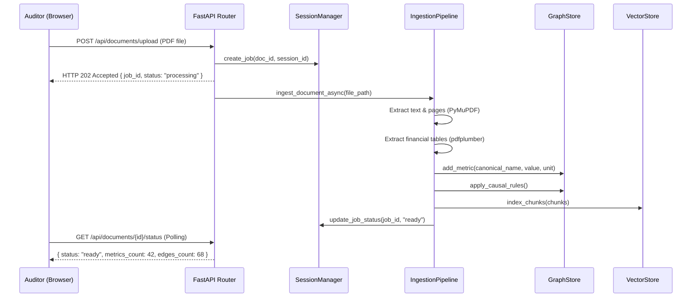
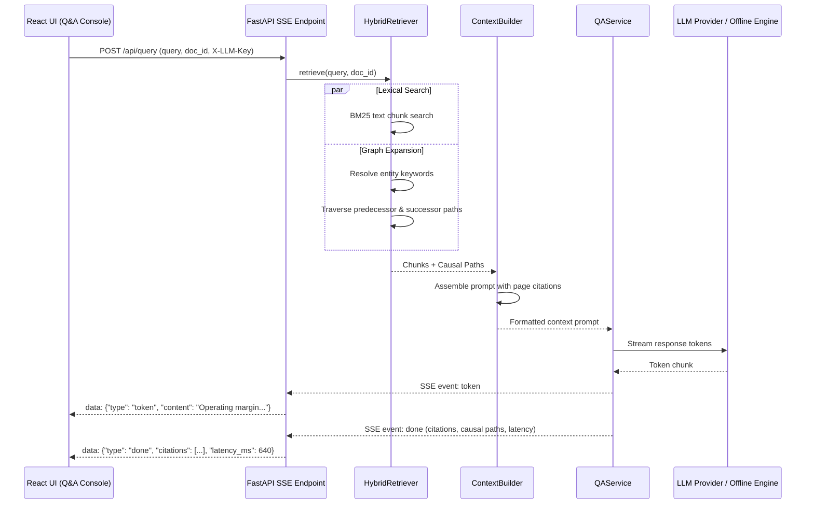

This page documents the dynamic interactions between frontend, backend, storage, and reasoning components during document ingestion and question answering.

---

## 1. Document Ingestion Flow

The ingestion pipeline executes asynchronously in the background so that large PDF files do not block the HTTP event loop.

---

## 2. Streaming Audit Q&A Flow

Audit questions utilize Server-Sent Events (SSE) to push incremental markdown tokens and citation metadata to the user interface.

---

## Key Reliability Invariants

1. **Non-blocking ingestion**: Document parsing runs in a background thread executor. The user receives an immediate job receipt.
2. **Deterministic fallback**: If a cloud model API returns an error or exceeds rate limits, `QAService` catches the exception and falls back to `OfflineEngine` to preserve system availability.
3. **Session scoping**: Documents, jobs, and graph instances are isolated by session identifiers provided in the `X-Session-ID` header.
