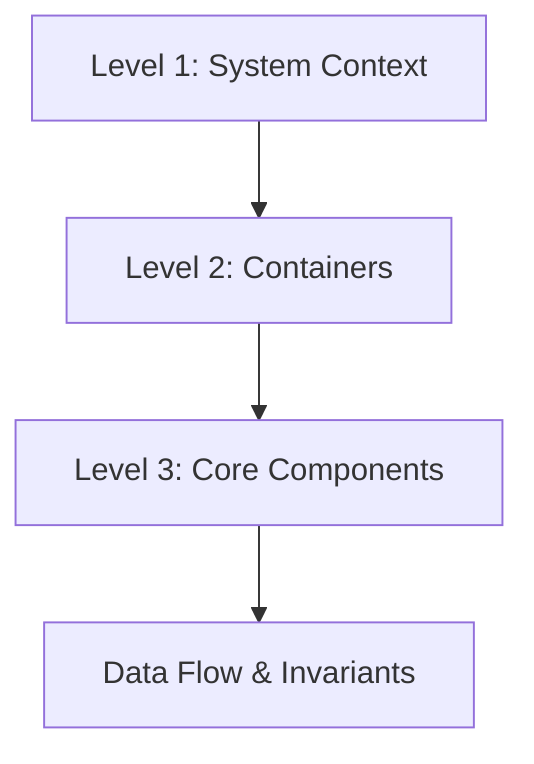

AuditIt is structured using the C4 model to articulate software architecture across distinct abstraction tiers. It decouples an editorial achromic React client from an asynchronous FastAPI backend and a specialized graph extraction engine.

---

## Architectural Hierarchy

---

## Architecture Sections

<Cards>
  <Card
    title="System Context"
    description="Level 1 C4 diagram defining human actors, external LLM reasoning providers, and graph databases."
    href="/docs/architecture/system-context"
  />
  <Card
    title="Containers"
    description="Level 2 C4 diagram covering the React 19 SPA, FastAPI service, in-memory store, and Neo4j adapter."
    href="/docs/architecture/containers"
  />
  <Card
    title="Components"
    description="Level 3 C4 diagram detailing PDF parsers, table extractors, deep GraphStore, and hybrid retrievers."
    href="/docs/architecture/components"
  />
  <Card
    title="Data Flow"
    description="End-to-end execution sequences for document ingestion and real-time SSE audit question answering."
    href="/docs/architecture/data-flow"
  />
  <Card
    title="Codebase Map & Invariants"
    description="Directory structure, architectural boundaries, and critical developer invariants."
    href="/docs/architecture/codebase-map"
  />
</Cards>
