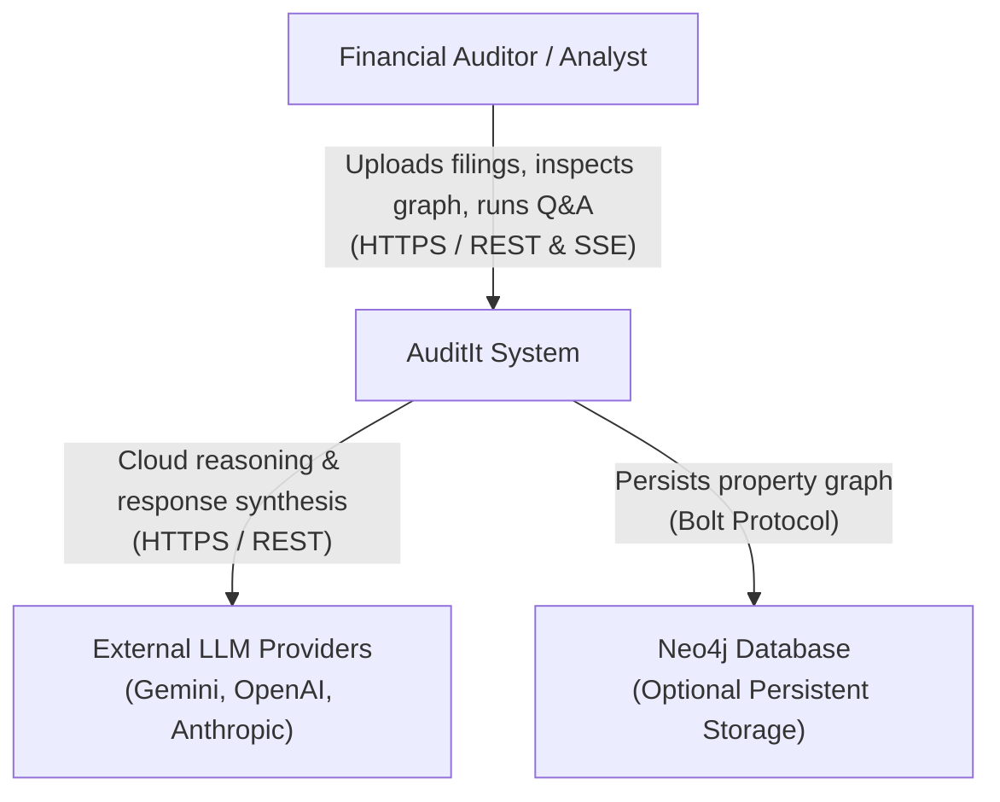

The System Context diagram describes the outer boundary of the AuditIt platform, highlighting human actors and external service integrations.

---

## Context Diagram

---

## Stakeholders and External Dependencies

### Primary Actors

- **Financial Auditor / Equity Analyst**: Uploads corporate annual reports (10-K, 10-Q), inspects extracted financial statements, navigates multi-hop causal dependency trees, and submits audit questions.

### External Systems

| System | Role | Integration Protocol | Failure Mode |
| :--- | :--- | :--- | :--- |
| **LLM Providers** | Cloud synthesis and natural language reasoning | HTTPS / JSON REST API | Fallback to Offline Grounded rule engine |
| **Google Gemini** | Default cloud provider (`gemini-3.8-flash`) | Google GenAI SDK | Switch to OpenAI, Anthropic, or Offline |
| **OpenAI** | Alternative reasoning provider (`gpt-4o-mini`) | OpenAI REST API | Fallback to Offline Grounded engine |
| **Anthropic** | Alternative reasoning provider (`claude-3-5-sonnet`) | Anthropic REST API | Fallback to Offline Grounded engine |
| **Neo4j** | Persistent property graph database | Bolt Protocol (`bolt://`) | Automatic fallback to in-memory NetworkX |

---

## Security and Network Boundaries

1. **Client Isolation**: User API keys are stored solely in the client browser's `localStorage` and sent per-request via the `X-LLM-Key` HTTP header.
2. **Stateless Gateway**: The backend server acts as an orchestrator and never writes user API keys to disk or database tables.
3. **Offline Guarantee**: When configured in Offline Grounded mode, no outbound internet requests are initiated by the system.
