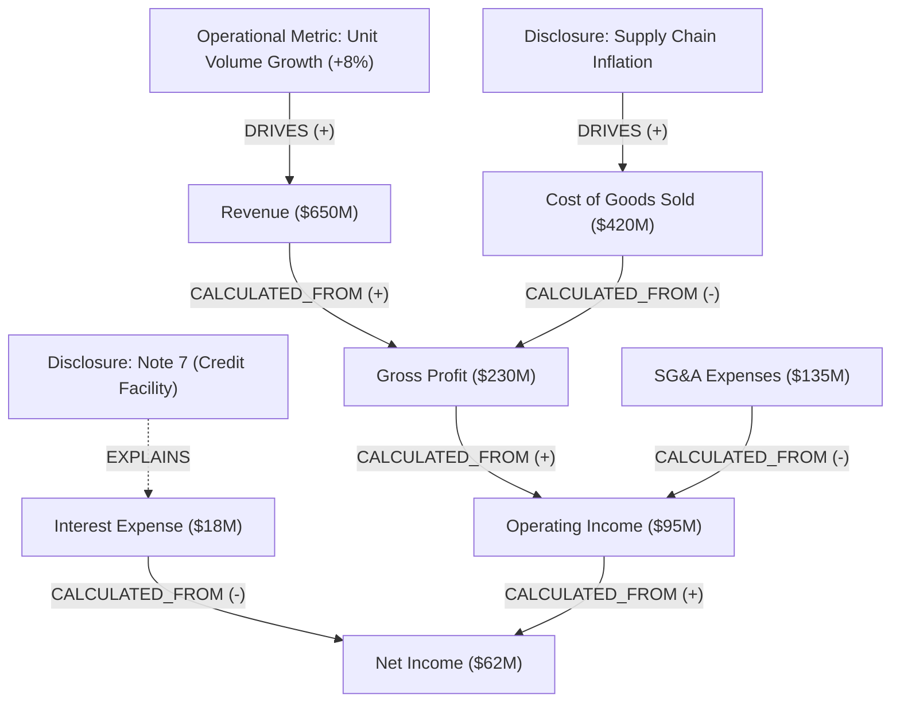

A causal financial graph is a directed attributed property graph that models financial line items, operating ratios, and qualitative disclosures as nodes, and their mathematical or explanatory dependencies as directed edges.

Standard financial reports present disconnected tables (balance sheets, income statements, cash flow statements) alongside unstructured commentary. A causal graph captures how shifts in operating drivers propagate through accounting identities to influence top-line performance metrics.

---

## Graph Formulation

The graph `G = (V, E)` unites two distinct node categories:

```
V = V_M ∪ V_D
```

### 1. Metric Nodes (`V_M`)

Quantitative entities representing reported line items or calculated ratios. Attributes include:

| Attribute | Type | Description |
| :--- | :--- | :--- |
| `name` | `string` | Canonical metric identifier (e.g. `gross_profit`, `revenue`) |
| `value` | `float` | Reported numerical scalar |
| `unit` | `string` | Currency (`USD`), ratio, percentage, or basis points |
| `period` | `string` | Reporting period (e.g. `FY2024`, `Q3_2024`) |
| `statement_type` | `enum` | Originating statement (`INCOME_STATEMENT`, `BALANCE_SHEET`, `CASH_FLOW`) |
| `source_page` | `int` | Document page index where the metric appears |

### 2. Disclosure Nodes (`V_D`)

Qualitative entities representing narrative footnotes, accounting policies, or risk factors that explain metric fluctuations. Attributes include:

| Attribute | Type | Description |
| :--- | :--- | :--- |
| `topic` | `string` | Categorical topic (e.g. `debt_covenants`, `foreign_exchange_exposure`) |
| `snippet` | `string` | Extracted textual evidence cited verbatim from the report |
| `source_page` | `int` | Document page index containing the disclosure |

---

## Edge Semantics and Directionality

Edges `E ⊆ V × V` are directed strictly from cause (driver) to effect (target):

- **`CALCULATED_FROM` (Deterministic Accounting Identity)**: Strict arithmetic defined by accounting standards.
  - Example: `Revenue -> Gross Profit` (+)
  - Example: `Cost of Goods Sold -> Gross Profit` (-)
- **`DRIVES` (Operational / Causal)**: Direct causal contribution documented in financial narrative.
  - Example: `Supply Chain Freight Inflation -> Cost of Goods Sold` (Direct)
  - Example: `Store Count -> Revenue` (Direct)
- **`OFFSETS` (Counteracting Impact)**: Mitigating factor that diminishes an adverse change.
  - Example: `Price Increases -> Unit Volume Decline` (Offsets margin deterioration)
- **`EXPLAINS` (Grounding Link)**: Connects a qualitative `DisclosureNode` to a `MetricNode`.
  - Example: `Note 7 (Credit Facility) -> Total Debt`

---

## Structural Visualization



---

## Graph Traversal Algorithms

Causal graphs enable deterministic queries along directed edges:

### Upstream Root-Cause Analysis (Predecessor Traversal)

Given a target metric experiencing unexpected variance (such as Gross Margin contracting 180 basis points), traverse incoming edges backwards to identify root causes:

```
Drivers(m) = { u ∈ V | path u → ... → m exists }
```

This traversal cleanly separates mechanical accounting identities (COGS growth outpaced revenue growth) from operational drivers (raw material freight surcharges cited on page 42).

### Downstream Sensitivity Traversal (Successor Traversal)

Given an operational shock (such as a 100 basis point rise in benchmark interest rates), traverse outgoing edges forward to project all affected downstream line items:

```
Impacts(s) = { v ∈ V | path s → ... → v exists }
```
