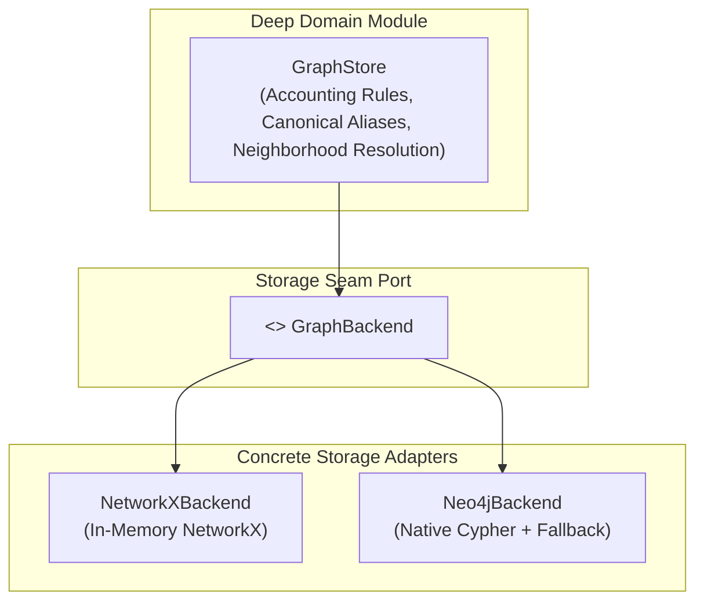

AuditIt employs a Ports and Adapters (Hexagonal) architecture to support both lightweight local analysis and enterprise-scale cross-report querying.

---

## Architectural Seam

The graph system separates accounting domain logic from graph database mechanics:

---

## The Deep Module Pattern

In traditional architectures, database queries and node dictionaries often leak across service boundaries. AuditIt prevents this through a deep module boundary:

- **`GraphStore` owns**:
  - Metric name normalization (e.g. mapping `total_revenues`, `turnover`, and `sales` to canonical `revenue`).
  - Accounting identity rules (e.g. `gross_profit = revenue - cogs`).
  - Neighborhood expansion logic and path pruning.
- **`GraphBackend` owns strictly**:
  - Primitive node insertion (`add_node`).
  - Primitive edge insertion (`add_edge`).
  - Directed neighbor queries (`get_predecessors`, `get_successors`).

Callers like `HybridRetriever` and API route handlers interact exclusively with `GraphStore`. They never interact with `NetworkX` graph objects or Cypher drivers directly.

---

## Backend Comparison

| Dimension | NetworkX Backend | Neo4j Backend |
| :--- | :--- | :--- |
| **Storage Medium** | Python Process Memory | Disk-backed Neo4j Database |
| **Setup Overhead** | Zero dependencies | Docker or cloud instance required |
| **Query Mechanism** | Python dict lookups & algorithms | Declarative Cypher statements |
| **Persistence** | Session lifetime only | Permanent cross-restart retention |
| **Cross-Filing Queries** | Not supported | Supported via shared database |
| **Ideal Environment** | Local dev, automated CI tests | Multi-report enterprise analysis |

---

## Parity Testing

To ensure seamless interchangeability between storage adapters, the test suite executes behavioral parity tests (`tests/test_graph_backend_parity.py`). Identical financial topologies are loaded into both backends, and multi-hop neighborhood queries are asserted to return matching node and edge sets.
