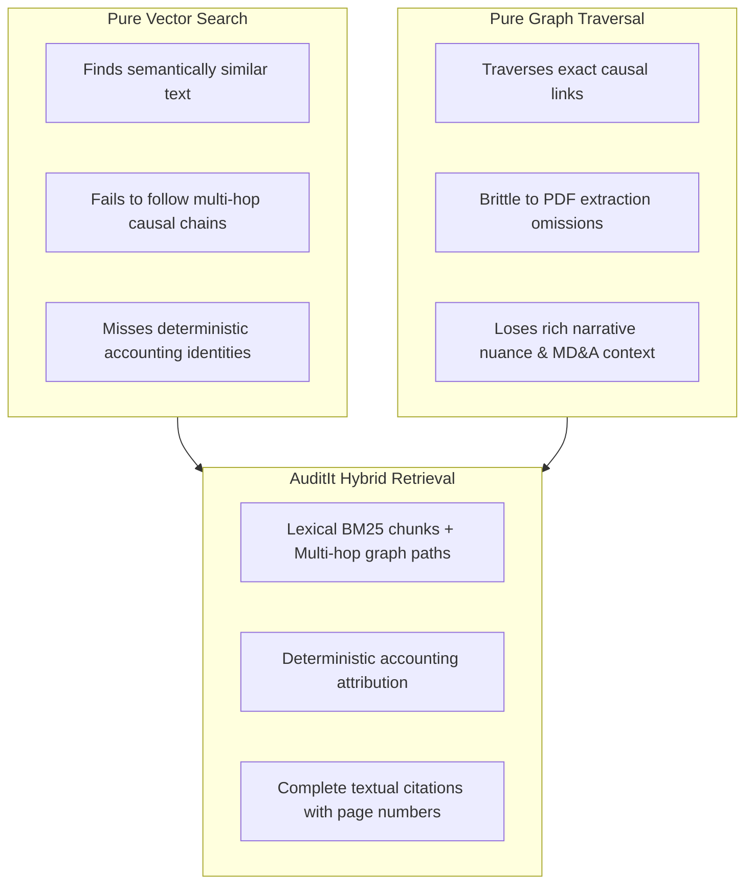
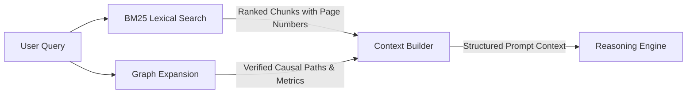

Corporate annual reports contain two complementary modalities of information: unstructured narrative disclosures (MD&A commentary, risk factors, accounting notes) and structured mathematical identities (balance sheet reconciliations and income statements).

AuditIt fuses lexical search with graph traversal to overcome the inherent blind spots of single-mode retrieval.

---

## Why Single-Mode Retrieval Fails

### The Limitations of Pure Vector Search

Standard RAG systems embed text chunks and query vector stores via cosine similarity. While effective for answering conversational questions, vector search cannot reliably trace multi-step causal chains across financial tables. Semantically similar chunks often omit the concrete mathematical calculations that explain metric movements.

### The Limitations of Pure Knowledge Graphs

Graph-only systems attempt to convert all disclosures into subject-predicate-object triples. While graph traversal is explainable and deterministic, qualitative audit commentary (such as macroeconomic headwind explanations or legal contingency discussions) resists clean triple extraction and is easily lost during ingestion.

---

## The Hybrid Solution

AuditIt's `HybridRetriever` runs both retrieval mechanisms in parallel:

1. **Lexical Vector Search (`BM25`)**: Ranks document text chunks against query keywords, guaranteeing that narrative explanations and footnotes are retrieved even if not fully modeled in the graph.
2. **Graph Traversal**: Identifies financial metric entities mentioned in the query and expands their 1-to-3 hop predecessor and successor neighborhoods.
3. **Context Assembly**: The `ContextBuilder` merges both inputs into a unified audit prompt, pairing qualitative text quotes with verified causal paths and exact page citations.
