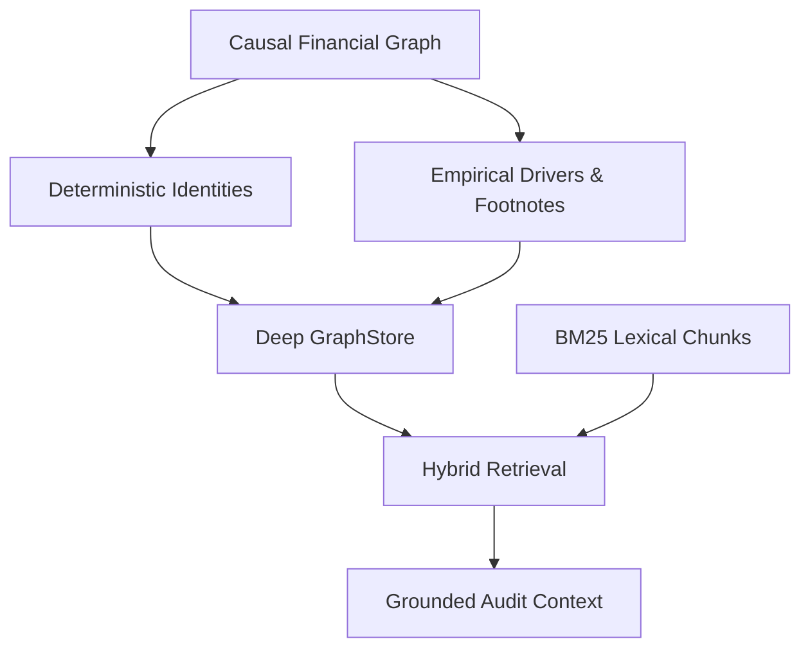

This section documents the theoretical and domain foundations underpinning AuditIt, from Judea Pearl's causal inference framework to deep modular graph architecture.

---

## Conceptual Architecture

---

## Core Topics

<Cards>
  <Card
    title="Causal Financial Graphs"
    description="Mathematical representation of financial statements as attributed property graphs using Judea Pearl's causality."
    href="/docs/concepts/causal-financial-graphs"
  />
  <Card
    title="Dual Graph Backend"
    description="Ports and Adapters architecture decoupling domain logic from NetworkX and Neo4j storage engines."
    href="/docs/concepts/dual-graph-backend"
  />
  <Card
    title="Hybrid Retrieval"
    description="Coordinating vector search with directed graph traversal to supply grounded context for reasoning."
    href="/docs/concepts/hybrid-retrieval"
  />
  <Card
    title="Domain Glossary"
    description="Canonical definitions and domain terminology used throughout the AuditIt system."
    href="/docs/concepts/domain-glossary"
  />
</Cards>
