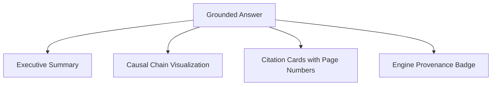

AuditIt pairs deterministic graph traversal with lexical search to answer complex accounting inquiries. Every answer is grounded in verifiable source text and explicit causal paths.

---

## Asking Audit Questions

Open the **Q&A** console for any active filing. You can enter arbitrary questions in natural language or click one of the suggested starter prompts:

- *"Why did operating margin contract in FY2024?"*
- *"What were the primary drivers behind gross profit deterioration?"*
- *"Did supply chain disruptions impact inventory valuation?"*
- *"Explain the foreign exchange hedging policy cited in footnote disclosures."*

---

## Response Anatomy

Each response generated by the system contains four distinct components:



### 1. Executive Summary

Synthesized analysis answering the prompt directly. Tokens stream progressively into the UI in real time via Server-Sent Events (SSE).

### 2. Causal Chain

When relationships are identified in the graph, the UI renders the explicit chain connecting drivers to the target metric:

```
[Supply Chain Inflation] -> DRIVES (+) -> [Cost of Goods Sold] -> OFFSETS (-) -> [Gross Profit]
```

### 3. Source Citations

Every statement references exact source document pages. Clicking a citation opens a drawer displaying:
- The exact excerpt snippet.
- The originating page index in the uploaded PDF.
- The retrieval similarity score.

### 4. Engine Provenance Badge

Displays the active reasoning engine (`Offline Grounded`, `Gemini 3.8 Flash`, `OpenAI`, or `Anthropic`) and the total round-trip generation latency in milliseconds.

---

## Reasoning Modes Compared

<Callout type="info">
  AuditIt supports completely offline execution. In **Offline Grounded** mode, the system parses retrieved graph tuples and BM25 excerpts using deterministic template logic without sending data over the network.
</Callout>

| Dimension | Offline Grounded Mode | Cloud Model Mode (BYOK) |
| :--- | :--- | :--- |
| **Network Calls** | Zero (100% Local) | Single HTTPS call to provider |
| **API Key Required** | None | Yes (stored in browser `localStorage`) |
| **Synthesis Method** | Rule-based template assembly | LLM natural language generation |
| **Latency** | < 50ms | 400ms to 1800ms |
| **Hallucination Risk** | Zero | Strictly grounded by system prompt |
