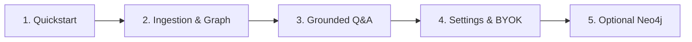

This section provides operational guides for installing, configuring, and operating AuditIt. Follow these walkthroughs to set up your environment, ingest financial filings, explore causal graphs, and conduct grounded inquiries.

---

## Suggested Reading Order

---

## Available Guides

<Cards>
  <Card
    title="Quickstart"
    description="System prerequisites, repository installation, and launching local development servers."
    href="/docs/guides/quickstart"
  />
  <Card
    title="Ingestion & Graph Exploration"
    description="Loading annual reports, monitoring ingestion progress, and navigating the causal dependency canvas."
    href="/docs/guides/ingestion-and-graph"
  />
  <Card
    title="Grounded Q&A"
    description="Submitting questions, streaming real-time tokens, and reviewing cited page snippets and causal paths."
    href="/docs/guides/grounded-qa"
  />
  <Card
    title="Settings & BYOK Keys"
    description="Switching between Offline Grounded and cloud LLMs (Gemini, OpenAI, Anthropic) with local key storage."
    href="/docs/guides/settings-and-byok"
  />
  <Card
    title="Neo4j Setup"
    description="Configuring persistent property graph storage with Docker and managing automatic in-memory fallback."
    href="/docs/guides/neo4j-setup"
  />
</Cards>
