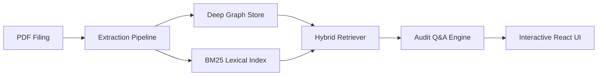

AuditIt converts corporate financial filings (such as 10-K and annual reports) into queryable causal knowledge graphs. It extracts financial metrics, accounting disclosures, and tabular statements, connects them by cause-to-effect relationships, and provides grounded question answering with page-level citations.

The platform operates fully locally in **Offline Grounded** mode without an external API key, and offers bring-your-own-key (BYOK) cloud reasoning with Google Gemini, OpenAI, and Anthropic.

---

## Architecture at a Glance

The diagram below illustrates how incoming financial reports pass through parsing, graph construction, hybrid retrieval, and grounded response synthesis:

---

## Core Capabilities

<Cards>
  <Card
    title="Causal Graph Construction"
    description="Connect financial metrics and footnote disclosures into directed cause-to-effect relationships."
    href="/docs/concepts/causal-financial-graphs"
  />
  <Card
    title="Hybrid Retrieval Pipeline"
    description="Combine BM25 text keyword search with multi-hop graph traversal for grounded context."
    href="/docs/concepts/hybrid-retrieval"
  />
  <Card
    title="Dual Graph Backends"
    description="In-memory NetworkX for fast local development and tests, pluggable Neo4j for persistence."
    href="/docs/concepts/dual-graph-backend"
  />
  <Card
    title="Audited Q&A with Citations"
    description="Stream answers with exact page numbers, verified causal chains, and latency metrics."
    href="/docs/guides/grounded-qa"
  />
</Cards>

---

## Explore the Documentation

<Cards>
  <Card
    title="Guides"
    description="Step-by-step guides for installing, loading filings, exploring graphs, and configuring models."
    href="/docs/guides"
  />
  <Card
    title="Architecture"
    description="C4 system context, container boundaries, component breakdowns, and data flow sequences."
    href="/docs/architecture"
  />
  <Card
    title="Core Concepts"
    description="Mathematical foundation of causal financial graphs, domain glossary, and storage design."
    href="/docs/concepts"
  />
  <Card
    title="Architecture Decisions"
    description="Records of key engineering choices including dual storage backends and hybrid retrieval."
    href="/docs/adr"
  />
  <Card
    title="API Reference"
    description="FastAPI REST endpoints and Server-Sent Events (SSE) streaming protocol documentation."
    href="/docs/api"
  />
</Cards>

---

<Callout type="info">
  To run the system locally right away, head over to the [Quickstart Guide](/docs/guides/quickstart). The demo includes bundled synthetic reports and runs entirely offline.
</Callout>
